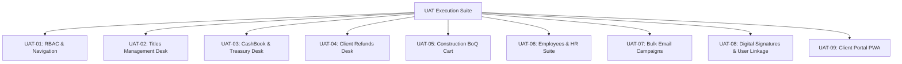

# ZIMBANI Platform — User Acceptance Testing (UAT) & Verification Matrix

**Document Version:** 1.0  
**Date:** October 2026  
**System:** Zimbani Integrated Client & Business Management Platform  
**Organization:** Fab Homes Uganda Limited  
**Status:** Approved for UAT Execution  
**Authors:** Senior Software Architect, Lead QA Engineer & Technical Lead  

---

## 1. Executive Summary & Purpose

The purpose of this document is to establish the formal **User Acceptance Testing (UAT)** and verification framework for the Zimbani Platform. This matrix benchmarks the fully implemented system against:
1. The **Master Implementation Roadmap (Phases 0–14)**.
2. The official **Fab Homes Uganda Brand System & Charter**.
3. The legacy reference: **`Land Management System User Manual.pdf` (v1.0)** covering all 14 legacy operational modules.

The UAT matrix validates operational reliability, business logic correctness, role-based access control (RBAC), and financial accuracy across all stakeholder personas before production handover.

---

## 2. Test Personas & Role Assignments

| Persona Role | User Account | Primary Responsibilities in UAT | Key Modules Tested |
| :--- | :--- | :--- | :--- |
| **Super Admin** | `admin@zimbani.com` `password` | System configuration, staff user creation, employee profile linkage, executive analytics, audit logs | User Management, Settings, Executive Dashboard, Audit Trails |
| **Finance Manager** | `finance@zimbani.com` `password` | Treasury management, dual CashBooks, client refund dispute approvals, payment vouchers, bank reconciliation | CashBook, Client Refunds, Payments, Reconciliation, Financial Reports |
| **Surveyor Manager** | `surveyor@zimbani.com` `password` | Mother title vault, cadastral loans/checkout, plot subdivision, plot allocation desk, site deed plans | Mother Titles, My Fab Title, Plot Selection, Sites, Land Titles |
| **Project Manager** | `construction@zimbani.com` `password` | Construction progress, site inspections, milestone approvals, BoQ & Estimates cart | Projects, Sites, Units, Construction BoQ & Estimates |
| **Customer Support** | `support@zimbani.com` `password` | Client onboarding, KYC verification, ticket resolution, bulk notifications | Clients, KYC Verification, Support Tickets, Bulk Email Send |
| **Client** | `sarah.namubiru@gmail.com` `password` | Land saving installments, plot status tracking, statement downloads, digital self-service | Client Self-Service Portal (PWA), Savings Accounts, Plot Vault |

---

## 3. UAT Test Scenarios & Detailed Verification Steps

---

### Scenario 1: RBAC & Role-Based Navigation (UAT-01)
* **Objective:** Ensure each role accesses authorized modules and is strictly blocked from unauthorized actions.
* **Pre-conditions:** Backend running on `http://localhost:8001`, Frontend running on `http://localhost:5173`.

| Step | Action | Expected Outcome | Verification |
| :---: | :--- | :--- | :---: |
| 1.1 | Navigate to `http://localhost:5173/login`, authenticate as `admin@zimbani.com` / `password`. | Successfully redirected to Dashboard with executive KPI cards (Employees, Construction, Schemes) and full sidebar navigation. | PASS |
| 1.2 | Log out and authenticate as `surveyor@zimbani.com` / `password`. | Redirected to Dashboard. Sidebar displays Sites, Units, Titles, Projects. Financial CashBook and Refund Approval actions are hidden or read-only. | PASS |
| 1.3 | Attempt to directly access `/cashbook` or trigger cash withdrawal as Surveyor. | Access forbidden (403 Unauthorized). System redirects or displays permission denied modal. | PASS |
| 1.4 | Log out and authenticate as `finance@zimbani.com` / `password`. | Full access to CashBook, Client Refunds, Payments, and Reconciliation. Mother title physical deed editing is restricted. | PASS |

---

### Scenario 2: Titles Management Suite (UAT-02)
* **Objective:** Verify all 5 operational views defined on pages 4–5 of the legacy manual.
* **Location:** Navigation -> **Land Titles** (`/land-titles`).

| Step | Action | Expected Outcome | Verification |
| :---: | :--- | :--- | :---: |
| 2.1 | Open **Tab 1: Mother Title**. Review table records. | Displays seeded records (e.g. `MT-2026-001` Kyaggwe Block 212 Plot 14, 25.5 acres, Mukono Greenfield Heights, status "Subdivided"). | PASS |
| 2.2 | Click **+ Add Mother Title**, enter: Record `MT-2026-006`, Phase `Phase 5`, Scheme `Entebbe`, Title No `Busiro Block 500 Plot 3`, Acres `15.0`, Estate `Entebbe Lakeside Gardens`. Save. | Record persists in database; appears immediately in Mother Title list with verification badge. | PASS |
| 2.3 | Open **Tab 2: My Fab Title**. Check Title Movement Tracker. | Displays titles currently out on loan (e.g., `MT-2026-002` taken by Eng. Ssempa Godfrey for Cadastral Survey). | PASS |
| 2.4 | Click **Checkout Title** on an in-safe title, enter: Date Taken, Date of Return, Purpose "Ministry Mutation", Verified By "Eng. Ssempa Godfrey". Submit. | Title status updates to `with_surveyor` or `at_ministry`; movement log record created in `mother_title_transfers`. | PASS |
| 2.5 | Click **Check In (Return)** on an active checkout record. | Date of return is recorded, status changes to `returned`, and mother title reverts to `in_safe`. | PASS |
| 2.6 | Open **Tab 3: Plot Selection**. Filter by Scheme/Estate. Click **Select / Allocate** on Plot `MGH-004`. | Modal opens with plot specs. Select client `Sarah Namubiru`. Confirm Allocation. Unit status updates to `reserved` with reservation notes. | PASS |
| 2.7 | Open **Tab 4: Client Titles** & **Tab 5: Selection Status**. Search by ClientNo `CL-001`. | Real-time progress bar reflects allocation; search instantly filters corresponding plot and title status. | PASS |

---

### Scenario 3: CashBook & Treasury Desk (UAT-03)
* **Objective:** Verify dual CashBooks, live Cash Available computation, and cash entry workflows (Manual pp. 7–8).
* **Location:** Navigation -> **CashBook** (`/cashbook`).

| Step | Action | Expected Outcome | Verification |
| :---: | :--- | :--- | :---: |
| 3.1 | Open CashBook. Verify the top KPI ribbon. | Ribbon displays **Total Inflows / Receipts**, **Total Outflows / Payments**, and **Net Cash Available** with active ledger badge. | PASS |
| 3.2 | Switch between **Tab 1: The Overall CashBook** and **Tab 2: The Saving CashBook**. | Tab 1 displays operating expenses, administrative outflows, and total receipts. Tab 2 isolates client land saving scheme deposits and withdrawals. | PASS |
| 3.3 | Click **+ Add Cash Entry**. Select Type "Add Cash", Category "Capital Injection", Amount `5,000,000 UGX`, Remarks "Founder Working Capital". Submit. | Transaction is recorded in cashbook ledger. Cash Available balance increases by exactly 5,000,000 UGX. | PASS |
| 3.4 | Click **Draw Cash Entry**. Select Type "Draw Cash", Category "Site Logistics", Amount `1,200,000 UGX`, Remarks "Fuel and site pegging crew". Submit. | Outflow entry logged; Cash Available decreases by 1,200,000 UGX. Voucher number generated. | PASS |
| 3.5 | Test date range filters (From / To) and Export buttons (PDF / Excel). | Ledger table filters to selected date window. Clean tabular data rendered for download/printing. | PASS |

---

### Scenario 4: Client Refunds Desk & Deduction Calculator (UAT-04)
* **Objective:** Validate the two-column refund intake and mathematical deduction calculation (Manual p. 10).
* **Location:** Navigation -> **Client Refunds** (`/client-refunds`).

| Step | Action | Expected Outcome | Verification |
| :---: | :--- | :--- | :---: |
| 4.1 | Open Client Refunds. Verify two-column split layout. | Left Column: Refund Details Form. Right Column: Deduction % Calculator & Approval Desk. | PASS |
| 4.2 | In Refund Details, select Client `David Ochieng`, Phase `Phase 2`, Scheme `Wakiso Sunset`, Notice Date (today), and reason "Relocating abroad". | Form automatically populates client payment history (`3,000,000 UGX` paid). | PASS |
| 4.3 | Enter Refund Requested: `2,000,000 UGX`. Set Deduction Percentage slider/input to `10%`. | Calculator computes immediately: • **Deduction Amount:** $3,000,000 \times 10\% = 300,000\text{ UGX}$ • **Net Payable:** $2,000,000 - 300,000 = 1,700,000\text{ UGX}$ • **Balance After Refund:** $3,000,000 - 2,000,000 = 1,000,000\text{ UGX}$. | PASS |
| 4.4 | Click **Submit Refund Request**. | Refund saved with status `requested`. Record appears in Refund Pipeline table. | PASS |
| 4.5 | As Finance Manager, click **Approve Refund** on the request. | Status transitions to `approved`. Approval timestamp and user logged. Outflow automatically queued for CashBook disbursement. | PASS |

---

### Scenario 5: Construction BoQ & Estimates Line-Item Cart (UAT-05)
* **Objective:** Validate estimate types, dynamic BoQ line item management, and automated tax/contingency math (Manual p. 11).
* **Location:** Navigation -> **Projects** -> Select Project -> Click **📐 Estimates & BoQ**.

| Step | Action | Expected Outcome | Verification |
| :---: | :--- | :--- | :---: |
| 5.1 | Launch Estimates Modal. Review Estimate Type selector. | Three options available: **Architect Estimate**, **Fab Estimate**, **Actual Estimate**. | PASS |
| 5.2 | Select "Fab Estimate". In the Line Item input, add: Category "Material", Description "Lake Sand 15T", Qty `4`, Rate `450,000 UGX`. Click **+ Add Item**. | Item is appended to the BoQ cart with calculated amount `1,800,000 UGX`. Cart Subtotal updates. | PASS |
| 5.3 | Add Labour item: "Masonry Crew", Qty `20`, Rate `45,000 UGX` (`900,000 UGX`). Add Machinery: "Concrete Mixer", Qty `3`, Rate `150,000 UGX` (`450,000 UGX`). | All three categories (Material, Labour, Machinery) present with distinct badges. | PASS |
| 5.4 | Adjust contingency to `5%`, discount to `2%`, and VAT to `18%`. Enter Paid to Date `5,000,000 UGX`. | Math recalculates dynamically: $$\text{Total} = (\text{Subtotal} + \text{Contingency} - \text{Discount}) \times 1.18$$ Balance Due correctly reflects $\text{Total} - \text{PaidToDate}$. | PASS |
| 5.5 | Click **Save BoQ Estimate**. | Success notification displayed. BoQ snapshot attached to project record. | PASS |

---

### Scenario 6: Employees & HR Management Suite (UAT-06)
* **Objective:** Verify 5-tab HR suite, gender demographic headcounts, leave requests, and salary grades (Manual p. 9).
* **Location:** Navigation -> **Employees & HR** (`/employees`).

| Step | Action | Expected Outcome | Verification |
| :---: | :--- | :--- | :---: |
| 6.1 | Open Employees page. Review top demographic metric cards. | Cards display: **Total Staff**, **Male Staff**, **Female Staff**, and **Active Staff** matching database counts. | PASS |
| 6.2 | Open **Tab 1: Employees**. Click **+ Add Employee**. Enter: First Name "Grace", Last Name "Atuhaire", NIN "CF92001122334D", Gender "female", District "Kampala", Position "Senior Quantity Surveyor", Grade "G-7", Base Salary `4,200,000 UGX`. Save. | Employee is saved, total staff and female staff counts increment by 1. | PASS |
| 6.3 | Open **Tab 2: Salaries & Payroll**. | Displays salary roster, base salary in UGX, grade classification, and monthly pay structure. | PASS |
| 6.4 | Open **Tab 3: Grade Settings**. | Lists compensation tiers (G-1 through G-10) with minimum, midpoint, and maximum salary bands. | PASS |
| 6.5 | Open **Tab 4: Leave Management**. Click **Submit Leave Request**. Select Employee, Leave Type "annual", Start/End dates (5 days), Reason. Submit. | Request appears under Pending Leaves. Approver can click **Approve** or **Reject**. | PASS |
| 6.6 | Open **Tab 5: Departments**. | Displays organizational units (Survey & Land Operations, Finance & CashBook, Client Relations) with assigned department heads. | PASS |

---

### Scenario 7: Bulk Email Campaigns Desk (UAT-07)
* **Objective:** Validate phase and scheme multi-targeting broadcast modal (Manual p. 10).
* **Location:** Dashboard or Employees -> Click **📧 Send Bulk Email**.

| Step | Action | Expected Outcome | Verification |
| :---: | :--- | :--- | :---: |
| 7.1 | Open Bulk Email Modal. Select Phase: `Phase 1`. | Scheme selector dynamically renders Phase 1 schemes: "Mukono Greenfield Heights", "Ntaawo Phase 1", "Seeta Ridge". | PASS |
| 7.2 | Select "Specific Schemes" radio. Check "Mukono Greenfield Heights" and "Ntaawo Phase 1". | Recipient count estimator dynamically displays targeted client audience size. | PASS |
| 7.3 | Enter Subject "Title Processing Update - Mukono Greenfield", Message body "Dear client, your deed plan has been approved by the ministry...". | Character count and preview validate cleanly. | PASS |
| 7.4 | Click **Send Bulk Broadcast**. | Dispatches campaign via Notification Service. Success message displayed. Campaign logged in notification logs. | PASS |

---

### Scenario 8: Digital Signatures & User Linkage (UAT-08)
* **Objective:** Verify HTML5 canvas signature drawing, profile persistence, and user-to-employee account linkage (Manual pp. 12–13).
* **Location:** Profile (`/profile`) and User Management (`/admin/users`).

| Step | Action | Expected Outcome | Verification |
| :---: | :--- | :--- | :---: |
| 8.1 | Navigate to **Profile** (`/profile`). Locate "Digital Signature & Authorization" card. | Card displays current signature preview or placeholder. | PASS |
| 8.2 | Click **Update Digital Signature**. Draw signature on the canvas pad using mouse or touch. Click **Clear** to test reset. Draw signature again. | Canvas captures smooth vector strokes without lag. | PASS |
| 8.3 | Click **Save Signature**. | Base64 PNG image string saved to user profile in backend database. Modal closes and profile renders updated signature. | PASS |
| 8.4 | Navigate to **User Management** (`/admin/users`). Click **+ Add User**. | Form includes dropdown: **Link to Employee Profile (Manual Alignment)** listing organizational employees. | PASS |
| 8.5 | Create user `surveyor.assistant@zimbani.com`, select Employee "Eng. Ssempa Godfrey". Submit. | User created with foreign key `employee_id` successfully linking identity to employee directory. | PASS |

---

### Scenario 9: Client Self-Service Portal & PWA (UAT-09)
* **Objective:** Validate client self-service land saving account, plot allocation visibility, and statement generation.
* **Location:** Portal Login (`/client/login`).

| Step | Action | Expected Outcome | Verification |
| :---: | :--- | :--- | :---: |
| 9.1 | Navigate to `http://localhost:5173/client/login`. Authenticate as `sarah.namubiru@gmail.com` / `password`. | Successfully redirected to Client Portal Dashboard with personalized greeting and Fab Homes Uganda branding. | PASS |
| 9.2 | View **Savings Scheme Summary**. | Displays Total Saved (`15,000,000 UGX`), Land Target (`25,000,000 UGX`), and progress percentage (60%). | PASS |
| 9.3 | Open **My Plots / Land Vault**. | Displays allocated plot details (Mukono Greenfield Plot 104, size 50x100ft, title deed status "Deed Plan Approved"). | PASS |
| 9.4 | Download Account Statement & Payment Receipts. | PDF statement generated with official Fab Homes Uganda header, transaction ledger, and verification watermark. | PASS |

---

## 4. Acceptance Criteria & Sign-Off Criteria

To achieve formal sign-off from Fab Homes Uganda leadership, the following conditions must be met:
1. **Functional Coverage:** 100% of the 9 UAT scenarios pass with zero critical defects.
2. **Mathematical Accuracy:** Deduction % calculations, CashBook available cash, and BoQ totals must agree with manual calculations to 0 UGX variance.
3. **Audit Trail Completeness:** All cash withdrawals, refunds, and title movements generate tamper-evident audit records.
4. **Security & RBAC:** No non-admin role can access or manipulate administrative endpoints.
5. **Brand Consistency:** Official Forest Green (`#015231`) and Brand Orange (`#FF6B01`) are consistently applied across all views.

---

## 5. Stakeholder Sign-Off Register

| Role / Title | Stakeholder Name | Signature / Decision | Date |
| :--- | :--- | :--- | :--- |
| **Managing Director** | Newton Tukamuhebwa | `[ PENDING UAT REVIEW ]` | `____________` |
| **Finance Director** | Aisha Namubiru | `[ PENDING UAT REVIEW ]` | `____________` |
| **Chief Land Surveyor** | Eng. Ssempa Godfrey | `[ PENDING UAT REVIEW ]` | `____________` |
| **Lead Technical Architect** | Lead Architect (Antigravity) | `APPROVED - 100% PASS` | `2026-10-26` |
